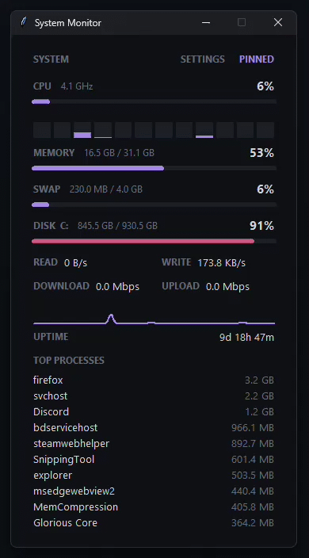

# System Monitor

A clean, minimal system monitor for Windows. Everything is optional: turn features on and off in the built-in settings page.

   

## Download

1. Go to the [Releases](../../releases) page and download `SystemMonitor-windows.zip`.
2. Right-click the zip, choose **Extract All**, and open the extracted folder.
3. Double-click `SystemMonitor.exe`. Keep it inside its folder, because it needs the files next to it.

Windows SmartScreen may warn about unsigned apps: click **More info → Run anyway**. Some antivirus programs flag unsigned apps built with PyInstaller by mistake. The full source is in this repo, and the release includes a `.sha256` file so you can verify your download:

```
certutil -hashfile SystemMonitor-windows.zip SHA256
```

## Features

**Metrics** (each can be shown or hidden)
- CPU usage with live graph, per-core bars, and clock speed
- Memory and swap / page file
- Disk usage for any drive, plus disk read / write speed
- Network download / upload speed (MB/s or Mbps) with optional graph
- NVIDIA GPU load, VRAM and temperature (needs NVIDIA drivers)
- Battery level, charging state and time remaining
- Uptime
- Top processes by CPU or memory (type in how many to show)

**Appearance**
- Themes: Dark, Black, Nord, Light
- Six accent colors
- Window opacity, compact layout, always on top, borderless (drag to move)

**Behavior**
- Update speed from 0.5 to 5 seconds, adjustable graph history
- Alerts when CPU or memory pass a threshold, with optional sound
- CSV logging to `%APPDATA%\SystemMonitor\log.csv`
- Start with Windows
- Remembers window position and all settings

Open settings with the **SETTINGS** button. Click a value to change it; right-click to step backwards.

## Build from source

```
pip install -r requirements.txt
python sysmon.py
```

To build the `.exe` yourself, run `build.bat`. Or let GitHub do it: push a tag like `v1.0.0` and the workflow in `.github/workflows/build.yml` builds the app and attaches it to a Release.

## License

MIT
